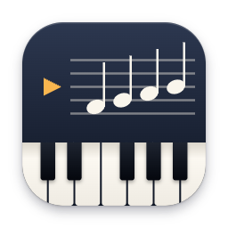

#  PianoScribe

A native macOS app that turns a video or audio recording (MP4, MOV, M4A, MP3, WAV…) into piano sheet music.


```
MP4 ──AVFoundation──▶ 22 kHz mono ──Core ML (Basic Pitch)──▶ note/onset activations
    ──ScoreKit──▶ notes ─▶ tempo + beat tracking ─▶ quantize ─▶ key ─▶ left/right hand ─▶ measures
    ──▶ MusicXML ──Verovio (WKWebView)──▶ sheet music on screen
                 └─▶ export MusicXML / MIDI, print or Save as PDF, open in MuseScore etc.
```

Everything runs on-device. No Python or network access needed.

Picking the project back up? Start with [docs/HANDOFF.md](docs/HANDOFF.md) for current status, design details and next steps.

## Requirements

- macOS 13 Ventura or later
- Xcode 15 or later (or the matching Command Line Tools)

## Run it

**In Xcode:** open `Package.swift`, pick the **PianoScribe** scheme and **My Mac**, then press ⌘R.

**From Terminal:**

```bash
swift run PianoScribe                 # debug build, runs from Terminal
./scripts/build-app.sh --open         # release build -> build/PianoScribe.app, then launch
```

On the first transcription the app compiles the Core ML model once and caches it in
`~/Library/Application Support/PianoScribe/`. This takes a few seconds.

To try it out, open `Tests/TranscriberTests/Fixtures/ode-to-joy-test.mp4`. It's a synthesized piano
recording of *Ode to Joy* in G major with a slightly drifting tempo.

## Tests

```bash
swift test
```

- **ScoreKitTests** are golden tests. The expected outputs (note decoding, windowing, and full
  MusicXML for 4/4, 3/4 and 6/8, fixed-tempo/fixed-key variants) came from the Python reference
  implementation in `Tests/Reference/`, run on the same data. They also pass on Linux.
- **TranscriberTests** (macOS only) check that the Core ML model's output matches the ONNX reference
  on a real audio window. They also run the full MP4 → score pipeline on the test video and check
  the key (G major), the tempo and the melody.

## Using the app

- **Open** a file, or drop one on the window.
- **Score settings** apply instantly and don't re-run the model:
  - time signature (4/4, 3/4, 2/4, 6/8)
  - key (automatic or forced)
  - tempo (automatic, typed in, or the **½× / 2×** buttons when note values come out twice as fast or slow as they should)
  - rhythm grid (16ths, or 8ths for simpler notation)
  - hand split (automatic, or a fixed split note)
- **Note detection settings** map to Basic Pitch's onset threshold, frame threshold, minimum note
  length and "melodia trick", plus an overtone-ghost filter.
- **Play Score** plays the transcription through macOS's built-in General MIDI piano.
  **Play Original** plays the recording, so you can compare them.
- **Export** offers:
  - MusicXML
  - MIDI as notated (quantized, right and left hand on separate tracks)
  - MIDI as played (original timing)
  - **Open in Notation App**
  - **Print / Save as PDF** (choose *PDF › Save as PDF* in the print panel)

## What to expect

- **Solo piano** works well. The model finds most notes, but you'll still want to tidy up rhythms and
  hand splits in MuseScore or Dorico.
- **Full mixes** (vocals, drums, band) don't. Every instrument gets transcribed onto the piano
  staves, and turning a full song into a playable piano part is *arranging*, not transcription.
- The beat tracker follows gradual tempo drift, but not big rubato or sudden tempo changes.
  Triplets, multiple voices per hand and pedal markings aren't notated yet.

## How it's built

| Target | What it does |
|---|---|
| `ScoreKit` | Pure Swift with no Apple-only frameworks: Basic Pitch windowing/stitching and note decoding (a port of `basic_pitch/note_creation.py`), overtone cleanup, tempo estimation, dynamic-programming beat tracking, quantization, downbeat choice, Krumhansl–Kessler key finding, key-aware pitch spelling, hand assignment, measure/tie/beam layout, MusicXML and MIDI writers |
| `Transcriber` | `AudioDecoder` (AVAssetReader → 22,050 Hz mono Float32) and `BasicPitchModel` (Core ML, 2-second windows with 30-frame overlap) |
| `PianoScribe` | SwiftUI app; `score.html` + Verovio render the MusicXML in a `WKWebView` |

`Tests/Reference/` contains the Python reference implementation (`bp_ref.py`, `notation_ref.py`),
the test-audio synthesizer, and the fixture generator. If you change the notation algorithm, change
both implementations and regenerate the fixtures with `python3 gen_fixtures.py`. That needs numpy,
scipy and onnxruntime, plus `nmp.onnx` from the basic-pitch repo.

### Ideas for next steps

- A piano-specific model (for example ByteDance's high-resolution piano transcription, converted
  with coremltools) for better accuracy and pedal detection.
- Splitting a hand into two voices when it holds a long note under moving notes.
- Triplet detection, and an optional "simplify for beginners" mode.
- Separating the piano from other instruments first (for example Demucs) for non-solo recordings.

## Third-party components

- **Basic Pitch** by Spotify (Apache License 2.0). The Core ML model `nmp.mlpackage` is bundled
  unmodified. See `ThirdParty/basic-pitch-LICENSE.txt` and `ThirdParty/basic-pitch-NOTICE.txt`.
- **Verovio** 6.3.0 by RISM Digital Center (LGPL-3.0). `verovio-toolkit-wasm.js` is bundled
  unmodified and loaded as a separate script, so it can be swapped for any other Verovio build.
  See https://www.verovio.org and https://github.com/rism-digital/verovio.
